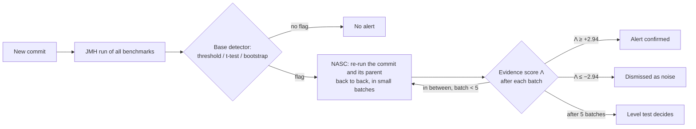
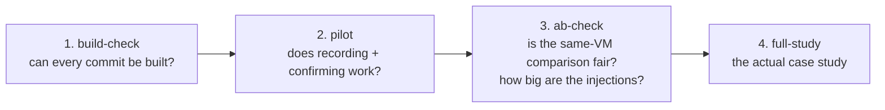
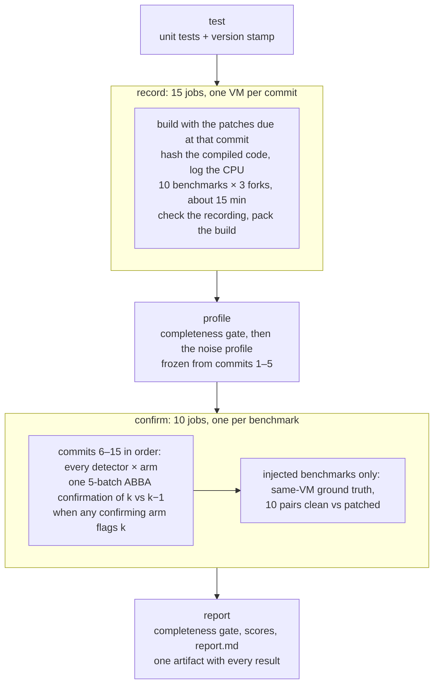

# NASC-CI case study on jenetics

**Does a confirmation layer for performance alerts work on a real project, in real CI?**
This branch answers that question for the thesis
*"Reducing False Performance Regression Alerts in Continuous Integration with Noise-Adaptive
Sequential Confirmation"* (Gregorious Abraham Karnadi, Zaheer Saleh Nahdi; BINUS University).

The JMH benchmarks of the Java library [jenetics](https://github.com/jenetics/jenetics) are measured
on GitHub Actions for 15 consecutive commits of its v4.4.0 release line. Three common detectors decide
whether each commit made a benchmark slower, and **NASC-CI**, the tool built in the thesis, decides
which of those alerts to keep.

The jenetics source itself is untouched: it lives on the other branches of this fork (`master`, tags
`v4.2.0` .. `v4.4.0`). Jenetics is licensed under the Apache License 2.0 (see `master`). Everything on
this branch (`nasc-case-study`) is the case study.

---

## Contents

1. [The problem, in short](#1-the-problem-in-short)
2. [What NASC-CI does](#2-what-nasc-ci-does)
3. [Study design](#3-study-design)
4. [The four workflows](#4-the-four-workflows)
5. [The full-study workflow in detail](#5-the-full-study-workflow-in-detail)
6. [Results of full study v1](#6-results-of-full-study-v1)
7. [How to run it yourself](#7-how-to-run-it-yourself)
8. [Repository layout](#8-repository-layout)
9. [Glossary](#9-glossary)

---

## 1. The problem, in short

Many projects run benchmarks on every commit and raise an alert when a benchmark looks slower than
before. But timing is noisy: the same code can measure 100 ms on one run and 103 ms on the next,
because of CPU type, heat, other processes, JIT compilation and memory layout. Many alerts are
therefore **false**; at Mozilla, 18.13 % of resolved alert summaries were closed as invalid. When most
alerts are false, developers stop reading them.

## 2. What NASC-CI does

NASC (Noise-Adaptive Sequential Confirmation) sits **behind** an existing detector. It does not
replace it.



- Each batch measures the candidate commit and its parent **on the same VM**, alternating the order
  (ABBA), so machine differences cancel out.
- The batch size `n_b` comes from each benchmark's own measured noise.
- The test is a truncated sequential probability ratio test (Wald) with α = β = 5 % and a smallest
  slowdown of interest δ_min = 2 %. It stops after at most K_max = 5 batches, so the extra CI time
  has a known upper bound.
- Clear cases stop after 1 to 2 batches. Static repetition, the alternative it is compared with,
  always runs 5.

## 3. Study design

| Item | Value |
|---|---|
| Project | jenetics, 15 consecutive first-parent commits before v4.4.0 (`case-study/commits.txt`) |
| Benchmarks | 10 studied (`study_settings.json`); of the 16 in `benchmarks.txt`, 6 `SeqPerf` benchmarks are excluded because they run at the timer floor |
| History | commits 1–5: recorded only, used to freeze the noise profile |
| Checked commits | 6–15: every benchmark is checked by every detector |
| Base detectors | threshold (p = 2 %), Perfherder-style t-test (τ = 2), Laaber's bootstrap (99 %) |
| Arms compared | **none** (no confirmation), **static** (always 5 batches), **static-mid** (static with a 1 % margin), **NASC** |
| Known slowdowns (ground truth) | `heapsort.patch` from commit 9 (slows heapSort80/250/320), `indexof.patch` from commit 13 (slows serialIndexOf250); both stay in later commits |
| Runner | GitHub-hosted `ubuntu-latest`; CPU model logged in every job |
| Java | Eclipse Temurin 1.8.0_514-b01, pinned, checksum verified |
| JMH | sample mode: `-bm sample -tu ns -f 3 -wi 10 -i 20 -w 1s -r 1s -foe true` (1 fork per run in A/B and confirmation runs) |

The injected slowdowns only add lines and do not change any result of the program; the
`INJECTED_EXTRA_PERCENT` constant sets their size. Their true size is measured on the same VM that
confirms them, because it depends on the CPU type.

## 4. The four workflows

All workflows are started by hand: **Actions tab → workflow name → Run workflow**. They share the
concurrency group `measurements`, so two measuring workflows never run at the same time. They were run
in this order:



### 4.1 `build-check.yml`: can every commit be built?

| | |
|---|---|
| Purpose | Check, without measuring anything, that every studied commit builds on Java 8 and contains all 16 benchmarks |
| Inputs | none |
| Jobs | `list` (reads `commits.txt`), then `build` (one job per commit, in parallel) |
| Steps per commit | check out jenetics at the commit → set up Temurin 8 (3 tries) → build the JMH jar → list the benchmarks (`jmh -l`) → `check_benchmarks.py` checks all 16 are present |
| Output | artifact `benchmark-list-<pos>`; a pass/fail line per commit in the job summary |
| Why it was needed | The 2019 build's `jmhJar` does not contain JMH itself, so JMH runs from the class path Gradle resolves (`print-jmh-classpath.gradle`, an init script applied from outside; no jenetics file is changed) |

### 4.2 `pilot.yml`: a two-commit dress rehearsal

| | |
|---|---|
| Purpose | Run the whole chain once, on a small scale, before spending hours of runner time |
| Inputs | none |
| Jobs | `test` (unit tests) → `record` (commits 1 and 2, each on its own VM, all 16 benchmarks, ~25 min) → `confirm` (builds both commits and forces one NASC confirmation of heapSort80 and serialIndexOf250) |
| Output | `report.md`, `pilot.json`, `history.json` |
| What it taught us | Two VMs can differ by about 60 % in raw speed, and NASC confirmed a slowdown that was not there. This led to NASC-CI 0.3: each batch is scaled by its own re-runs (*fresh scale*), batches use ABBA order, and the noise profile is frozen from earlier commits |

### 4.3 `ab-check.yml`: same-VM A/B check and calibration

| | |
|---|---|
| Purpose | (a) With two identical commits: check that the same-VM comparison reads about 0 % and has no order effect. (b) With an injection patch: measure how big the injected slowdown really is, per CPU type |
| Inputs | `a`, `b` (commit positions), `benchmarks` (empty = the patch's targets), `pairs` (default 10), `patch` (`none` / `heapsort` / `indexof`, applied to B only), `copies` (1–4 parallel jobs, each on its own VM) |
| Jobs | `test` → `ab` (one job per copy: build both commits, then `ab_check.py` runs 10 pairs per benchmark in ABBA order) → `summary` (pools the copies per CPU type with `ab_check.py pool --expected`) |
| Output | per copy `ab-check-a<A>-b<B>-<patch>-run<id>-copy<N>`; a summary artifact with the difference per CPU type |
| Result | Identical code: about 0 % difference, no significant order effect. Injections: heapsort ≈ +4 % (Intel) to ≈ +12 % (AMD 7763); indexof ≈ +34 % (AMD 9V74) |

### 4.4 `full-study.yml`: the case study

The main workflow, described step by step in the next section.

## 5. The full-study workflow in detail



| Job | Runs on | What it does | Artifact |
|---|---|---|---|
| `test` | 1 VM | Runs the unit tests and checks the NASC-CI version stamp, before any runner time is spent on JMH; lists the 15 commits with their patches | none |
| `record` | 15 VMs (one per commit) | Builds the commit with the injection patches due at that point (heapsort from 9, heapsort + indexof from 13), hashes the compiled code, logs the CPU, records the 10 benchmarks with 3 forks (`study.py record` checks the recording), and packs the build for the confirm jobs. Commits 9 and 13 also build the clean variant for the ground truth | `full-study-record-c<pos>`, `full-study-build-c<pos>` |
| `profile` | 1 VM | Refuses to continue unless all 15 recordings are complete, then freezes the noise profile (c_w, c_t, n_b per benchmark) from commits 1–5 | `full-study-profile` |
| `confirm` | 10 VMs (one per benchmark) | Walks commits 6–15 in order. Each detector × arm combination keeps its own window of 5 earlier versions. When any confirming arm flags commit k, one 5-batch ABBA confirmation of k against k−1 runs on this VM; NASC, static and static-mid read their decisions from the same batches. For the 4 injected benchmarks it then measures the true slowdown on this VM (10 clean-vs-patched pairs) | `full-study-confirm-<bench>`, `full-study-gt-<bench>` |
| `report` | 1 VM | Checks that every artifact is present, scores every detector × arm with the same rules as the simulation (`score_series`, `summarize_scores`), writes `report.md`, and uploads everything as one artifact | `full-study-report`, `full-study-run<id>-all` |

**Guards against silent failures.** A missing check must never count as "no alert", so:

- **G1**: every build is retried after 60 s and again after 180 s.
- **G2**: every job writes the step it reached to `out/stage.txt` and its logs to `out/*.log`; a failed
  job writes `out/FAILED.txt` with the last stage and the last 40 log lines.
- **G3**: `profile` and `confirm` need every `record` job, and `report` checks every artifact.
- **G4**: "Re-run failed jobs" re-runs only the failed jobs and keeps the good recordings.
- The report is marked **INCOMPLETE** and fails if anything is missing.

**Time.** About 650 runner minutes (435–855) and 65–90 minutes of wall time; run 45878011543 took
1 h 1 min. Results are kept 90 days and packed builds 14 days, so download the
`full-study-run<id>-all` artifact soon after the run.

## 6. Results of full study v1

Run [45878011543](https://github.com/znhd0x7/nasc-ci-case-study/actions/runs/45878011543), NASC-CI 0.3.
76 checks before an injection (clean) and 4 injected slowdowns.

| Detector | False-alert rate, no confirmation | with static | with NASC | Injections detected (NASC) | Extra blocks, NASC / static |
|---|---:|---:|---:|---:|---:|
| threshold | 56.6 % (43 of 76) | 3.9 % | **2.6 %** | 3 of 4 | 1152 / 1580 |
| t-test | 48.7 % (37 of 76) | 3.9 % | **2.6 %** | 3 of 4 | 896 / 1300 |
| bootstrap | 28.9 % (22 of 76) | 0.0 % | **0.0 %** | 3 of 4 | 542 / 870 |

- **False alerts.** Confirmation removed almost all false alerts. NASC's two remaining false alerts
  (heapSort80 and unevaluated at commit 8) are chance readings of about +1.6 % on identical code.
- **Cost.** NASC used 3.15 of 5 batches per confirmation on average. On the 5 benchmarks where
  confirmation is feasible it needed 0.38 of static's extra measurement, inside the simulation's range
  of 0.34–0.65. On the 5 noisy (infeasible) benchmarks it usually needed all 5 batches.
- **The miss.** NASC missed heapSort320 (+4.5 % on that VM). Its frozen profile predicted a pair
  standard deviation of 0.75 %, but identical code varied by about 3.9 %. The first batch happened to
  read −0.41 %, which under the small predicted noise was strong enough evidence to dismiss at K = 1.
  Static, which never stops early, caught it. The report's noise check flags this profile as clearly
  too low.
- **Limitation.** With 4 injected slowdowns among 100 benchmark-commits, the case study shows that
  NASC-CI works in real CI; error rates and costs with statistical weight come from the thesis
  simulation.

The full report with every confirmation, the same-VM ground truth and the CPU model of every VM is in
`report.md` of the run's artifact.

## 7. How to run it yourself

**On GitHub** (needs a fork of this repository with Actions enabled):

1. Actions tab → `build-check` → Run workflow. All 15 commits should build.
2. Actions tab → `full-study` → Run workflow (no inputs). Wait about 1–1.5 hours.
3. Open the `report` job's summary, or download the artifact `full-study-run<id>-all`.
4. If a job failed, use **Re-run failed jobs**; the good recordings are kept.

**Unit tests locally** (Python 3, numpy):

```
pip install numpy pytest
python -m pytest -q tests
```

The tests cover sample-mode iteration means, the A/B check with a simulated machine, and the study's
record, confirm and report logic. The thesis repository additionally checks on every push that this
case study decides and scores exactly like the thesis simulator (`src/nasc_sim.py`) for all four arms.

All study settings are in `case-study/study_settings.json`; changing anything there changes the study.

## 8. Repository layout

| Path | What |
|---|---|
| `case-study/commits.txt` | the 15 studied commits, oldest first |
| `case-study/benchmarks.txt` | the 16 candidate benchmarks (10 studied, see `study_settings.json`) |
| `case-study/study_settings.json` | every setting of the full study (commits, benchmarks, JMH options, NASC parameters, detectors, arms) |
| `case-study/study.py` | the full study: check recordings, completeness gate, frozen profile, confirmations, scores, report |
| `case-study/ab_check.py` | same-VM A/B check (ABBA pairs, order effect, same-VM noise, injected size per CPU type; `pool` combines copies) |
| `case-study/pilot.py` | the two-commit pilot (ran with NASC-CI 0.2) |
| `case-study/check_benchmarks.py` | checks a JMH benchmark list against `benchmarks.txt` |
| `case-study/print-jmh-classpath.gradle` | Gradle init script that prints the JMH class path (the 2019 jar does not include JMH) |
| `case-study/reference_noise_profile.csv` | reference noise (c_w, c_t, n_b) of the 16 benchmarks, from the traces of Laaber et al. (FSE 2020) |
| `case-study/calibration_background.json` | injected slowdowns measured per CPU type before the full study |
| `case-study/injections/` | `heapsort.patch` (extra `sink()` passes in `HeapSorter.sort`), `indexof.patch` (part of the search loop of `ProbabilitySelector.indexOfSerial` run again), `targets.txt` (first commit and affected benchmarks of each patch) |
| `nasc_ci/` | NASC-CI, the confirmation layer; `nasc_ci/VERSION` is the commit of the thesis source it was copied from |
| `tests/` | unit tests |
| `.github/workflows/` | the four workflows of section 4 |

## 9. Glossary

| Term | Meaning |
|---|---|
| JMH | Java Microbenchmark Harness, the standard tool for timing small pieces of Java code |
| fork | one fresh JVM process in which JMH runs a benchmark |
| base detector | the rule that first flags a possible slowdown (threshold, t-test, bootstrap) |
| arm | what happens after a flag: nothing (*none*), fixed 5 batches (*static*), or NASC |
| batch | one paired re-measurement of candidate and parent, `n_b` blocks each |
| ABBA | alternating order (B A, A B, …) so that warm-up or order effects cancel |
| c_w, c_t | noise within one JVM run and between runs; together they set `n_b` |
| feasible | a benchmark quiet enough that a 2 % slowdown can be confirmed within 5 batches |
| frozen profile | the noise estimates taken from commits 1–5 and kept fixed for commits 6–15 |
| FPR | false-positive rate: the share of clean checks that end in an alert |
| ground truth | the true size of an injected slowdown, measured on the confirming VM |
